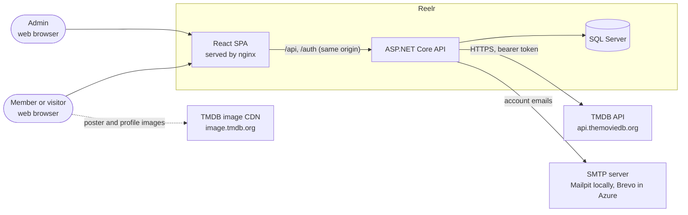
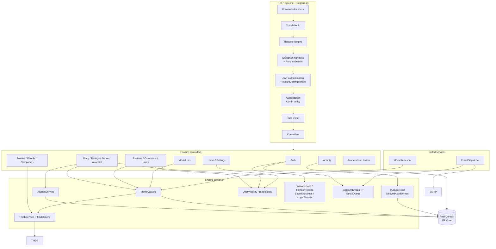
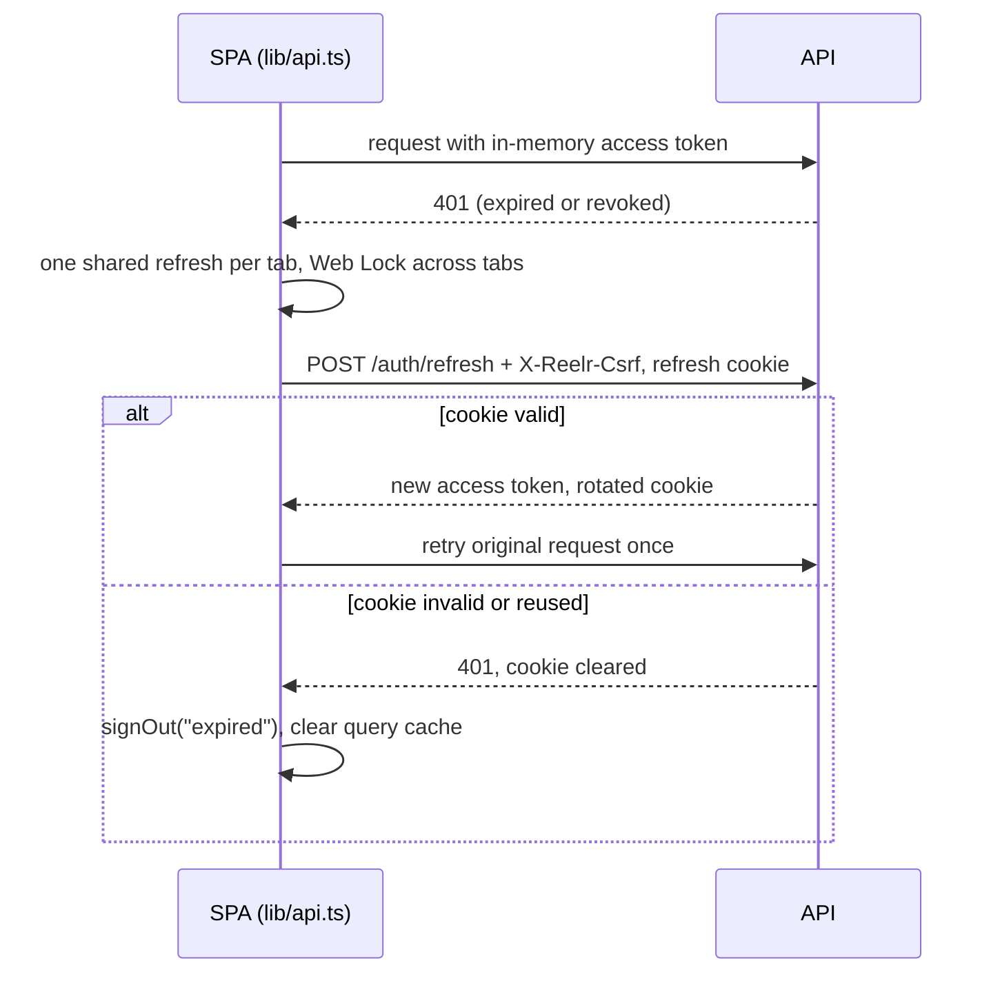

# Architecture

This document explains how Reelr is put together: the deployable parts, the layers inside the API, how a request moves through them, and the design decisions and risks visible in the code. For file-level navigation see [CODEBASE_GUIDE.md](CODEBASE_GUIDE.md).

## Architectural style

Reelr is a **single-page application in front of a monolithic REST API**, with one SQL Server database and one external data source (TMDB).

Inside the API the code is organised as **vertical feature slices**, not as horizontal layers. Evidence:

- Each folder under `backend/Features/` holds a feature's controller, entities, DTOs and, where needed, its services (for example `backend/Features/Diary/` has `DiaryController.cs`, `DiaryEntry.cs`, `JournalService.cs` and `DTOs/`).
- There is no separate repository, application or domain project. Controllers use the EF Core `ReelrContext` directly for simple reads and writes.
- Rules that several endpoints share are pulled into a small number of services or static helpers (listed under [Shared rule holders](#shared-rule-holders)).

This is a pragmatic style: little indirection, and a feature can be read in one folder. The cost is that controllers contain query logic and some patterns repeat (see [Risks and improvement areas](#risks-and-improvement-areas)).

## System context



The browser loads TMDB images directly from `image.tmdb.org` (`frontend/src/lib/tmdb.ts`); the nginx Content-Security-Policy allows that one image host (`frontend/security-headers.conf`). All other data goes through the API.

## Deployable components

| Component | Source | Runtime | Responsibility |
|---|---|---|---|
| Frontend | `frontend/` | Static files built by Vite, served by `nginxinc/nginx-unprivileged` (`frontend/Dockerfile`) | Renders the UI. nginx also reverse-proxies `/api/` and `/auth/` to the backend, sets security headers and caching, and adds `X-Correlation-Id` (`frontend/nginx.conf.template`). |
| Backend | `backend/` | `mcr.microsoft.com/dotnet/aspnet:10.0`, port 8080, non-root user (`backend/Dockerfile`) | The REST API, authentication, background jobs (email sending, film refresh). |
| Migrations | `backend/Dockerfile` target `migrations` | EF Core migrations bundle | Brings the schema up to date, then exits. The API never changes the schema itself (`backend/Program.cs` comment after `builder.Build()`). |
| Database | `docker-compose.yml` service `db`; `infra/resources.bicep` | SQL Server 2022 locally, Azure SQL serverless in production | All persistent state, including Data Protection keys. |
| Mailpit | `docker-compose.yml` | Local only | Catches outgoing email. |
| Fake TMDB | `e2e/fake-tmdb/server.mjs` | Local and CI end-to-end runs only | Deterministic TMDB stand-in. |

Because nginx proxies the API under the same origin, the API has no CORS configuration, and the refresh cookie can be `SameSite=Strict`.

### Production topology (Azure)

`infra/resources.bicep` defines one Container Apps environment with:

- `reelr` (frontend, external ingress, 0 to 1 replicas),
- `backend` (internal ingress only, reachable through nginx, 0 to 1 replicas, user-assigned managed identity),
- `reelr-migrate` (a Container Apps job run by the Deploy workflow before each rollout),
- an optional custom domain on the frontend with an Azure managed certificate,
- Azure SQL (serverless, free offer, auto-pause, Entra-only authentication), Key Vault for the JWT key, TMDB token and SMTP password, Log Analytics (30-day retention) and optional metric alerts.

See [INTEGRATIONS.md](INTEGRATIONS.md) for the Azure and GitHub details.

## Component view of the API



### Layers and boundaries

| Layer | Contents | Rule |
|---|---|---|
| Startup | `backend/Program.cs` | All service registration, options binding and pipeline order. Fails fast on missing secrets. |
| Controllers | `backend/Features/*/*Controller.cs` | Routing, validation, authorization attributes, mapping to DTOs, simple EF queries. |
| Shared rule holders | `JournalService`, `MovieCatalog`, `UserVisibility`, `BlockRules`, `DerivedActivityFeed`, `InviteCodes`, `RefreshTokens` | Rules used by more than one endpoint. Change rules here, not in controllers. |
| Integration clients | `TmdbService`, `SmtpEmailSender` | The only code that talks to external systems. |
| Persistence | `backend/Data/ReelrContext.cs`, `backend/Migrations/` | One DbContext for every feature, including ASP.NET Core Identity and Data Protection keys. |
| Cross-cutting | `backend/Features/Paging`, `Observability`, `Email`, `backend/Data/*ExceptionHandler.cs` | Paging contracts, logging, health, correlation ids, error mapping. |

There is no compile-time enforcement of these boundaries: everything is in one project (`backend/backend.csproj`).

### Shared rule holders

| Holder | Why it exists | Used by |
|---|---|---|
| `Diary/JournalService` | Watched status, rating, diary entries, review linkage and watchlist depend on each other. Keeping the rules in one class means every endpoint applies them the same way. | `DiaryController`, `RatingController`, `StatusController` |
| `Movies/MovieCatalog` | Films are stored locally only when someone interacts with them. It fetches from TMDB on first use and handles two requests creating the same film at once (the unique `TmdbId` index plus a retry read). | Diary, rating, status, watchlist, review and list endpoints; `MovieRefresher` |
| `Users/UserVisibility` | One place decides who may see a diary or watchlist. | `DiaryController`, `WatchlistController`, `UserController` |
| `Users/BlockRules` | Block checks as `IQueryable` extensions so they compose into queries. | Reviews, comments, likes, follows, feed |
| `Activity/IActivityFeed` | Lets the feed implementation change without touching the controller. | `ActivityController` |

## Dependency injection

Registration is explicit in `backend/Program.cs`; there is no assembly scanning. The lifetimes chosen matter for correctness:

| Lifetime | Services | Reason |
|---|---|---|
| Scoped | `ReelrContext`, `TokenService`, `RefreshTokens`, `MovieCatalog`, `JournalService`, `InviteCodes`, `AccountEmails`, `IActivityFeed` | Depend on the per-request DbContext. |
| Singleton | `EmailQueue`, `IEmailSender` (`SmtpEmailSender`), `SecurityStamps`, `SecurityLog`, `AdminAccess`, `DemoAccounts`, `LoginThrottle`, `TmdbCache` | Hold process-wide state (queues, caches, counters) or immutable configuration. `SecurityStamps` creates its own scope to read the database. |
| Typed HttpClient | `TmdbService` | Created by `AddHttpClient<TmdbService>` with `AddStandardResilienceHandler` (timeouts, retries, circuit breaker). |
| Hosted services | `EmailDispatcher`, `MovieRefresher` | Background loops. `MovieRefresher` creates a scope per run. |
| Exception handlers | `TmdbExceptionHandler`, `UniqueConflictExceptionHandler` | Map specific exceptions to 502/503 and 409 problem responses. |
| Factory | `IActivityFeed` | Chosen by `Activity:Implementation`; only `Derived` is accepted, anything else throws at resolution time. |

`AdminAccess` is constructed before `builder.Build()` so the authorization policy can capture it.

## Request lifecycle

The middleware order is set in `backend/Program.cs` and is deliberate:

1. `UseForwardedHeaders`: real client IP and scheme, trusted only from configured proxy networks.
2. `UseCorrelationId`: takes nginx's `X-Correlation-Id` or makes one; pushes it into every log line and into `HttpContext.TraceIdentifier`.
3. `UseRequestLogging`: one Serilog line per request, without the query string.
4. `UseExceptionHandler` and `UseStatusCodePages`: exceptions and empty error responses become `application/problem+json` with `correlationId`.
5. Swagger UI (Development) or HSTS (other environments), then HTTPS redirection.
6. `UseAuthentication`: JWT validation, then `OnTokenValidated` checks the token's security stamp against the database (cached 30 seconds).
7. `UseAuthorization`, then `UseRateLimiter` (global read and write limits plus named policies).
8. Controllers; health checks at `/health/live` and `/health/ready`.

### Example: logging a film

```mermaid
sequenceDiagram
    participant B as Browser (RatingDialog)
    participant N as nginx
    participant A as API pipeline
    participant C as DiaryController
    participant M as MovieCatalog
    participant T as TmdbService
    participant J as JournalService
    participant D as SQL Server

    B->>N: POST /api/movies/603/diary (Bearer token)
    N->>A: proxy, adds X-Correlation-Id, X-Forwarded-For
    A->>A: JWT valid? security stamp current? write rate limit
    A->>C: LogEntry(603, dto) after model validation
    C->>C: ValidateWatchedOn
    C->>M: GetOrCreateAsync(603)
    M->>D: SELECT Movie WHERE TmdbId = 603
    alt film not stored yet
        M->>T: GetMovie(603)
        T-->>M: TMDB JSON (cached 6 h)
        M->>D: INSERT Movie (409 race handled by re-read)
    end
    C->>J: LogAsync(user, movie, date, score, liked, rewatched, review, spoilers)
    J->>D: upsert Rating, WatchedMovie, Review; INSERT DiaryEntry; DELETE WatchlistItem
    J->>D: SaveChanges (one transaction)
    C-->>B: 200 DiaryEntryDto
    Note over B: useSaveDiaryEntry invalidates rating, status, diary, watchlist and review queries
```

### Example: SPA token handling



## Data flow

- **Film data**: TMDB is the source of truth. The API proxies most TMDB data straight through without storing it (`MovieController`, `PersonController`, `CompanyController`). It stores a slim `Movie` row (title, overview, dates, runtime, image paths) only when a member's action needs a foreign key. `MovieRefresher` re-copies stored films older than 30 days in batches every 6 hours.
- **Member data**: written through controllers and shared services into SQL Server. The feed is not stored; `DerivedActivityFeed` computes it from diary entries, reviews, lists and watchlists at read time.
- **Client state**: TanStack Query caches responses in the browser for 5 minutes by default (`frontend/src/main.tsx`) and is invalidated by mutation hooks in `frontend/src/lib/queries.ts`.

## External integrations

| System | Integration point | Failure behaviour |
|---|---|---|
| TMDB | `TmdbService` typed HttpClient | Timeouts 4 s per attempt and 10 s total, 2 retries, circuit breaker; failures become `TmdbUnavailableException` and then 502 or 503. Stored films still work. |
| SMTP | `EmailQueue` -> `EmailDispatcher` -> `SmtpEmailSender` | Requests never wait for email. Three retries, then the message is logged and dropped. |
| SQL Server | `ReelrContext` with `OpenRetryInterceptor` | Connection opening retries transient Azure SQL errors (for example a paused database waking). |

Details are in [INTEGRATIONS.md](INTEGRATIONS.md).

## Design patterns in use

| Pattern | Where |
|---|---|
| Vertical slices | `backend/Features/*` |
| Service for cross-entity invariants | `JournalService` |
| Get-or-create with optimistic concurrency | `MovieCatalog.GetOrCreateAsync` (unique index plus catch and re-read) |
| Atomic conditional update to avoid races | `RefreshTokens.RotateAsync`, `InviteCodes.ClaimAsync` (`ExecuteUpdateAsync ... WHERE UsedAt IS NULL`) |
| Strategy behind an interface with config selection | `IActivityFeed` / `DerivedActivityFeed` |
| Keyset (cursor) pagination | `Features/Paging/PageCursor.cs`, `PageQuery.cs`, `PageDto.cs`; `Activity/ActivityCursor.cs` |
| Producer and consumer queue | `EmailQueue` (bounded `Channel`) with `EmailDispatcher` |
| Cache-aside | `TmdbCache` in `TmdbService.GetFromTmdb`; `SecurityStamps` |
| Exception to ProblemDetails mapping | `TmdbExceptionHandler`, `UniqueConflictExceptionHandler`, `CorrelationId.AddToProblem` |
| Action filters for cross-cutting checks | `RequireCsrfHeaderAttribute`, `NotForDemoAccountsAttribute` |
| Source-generated logging | `SecurityLog` (`[LoggerMessage]`) |
| Design-time DbContext factory | `ReelrContextFactory`, so EF tools do not run the app's start-up checks |

## Architectural decisions visible in the code

Each decision below is stated in a code comment or README; the file is the evidence.

1. **Store films lazily, refresh periodically.** Avoids mirroring TMDB and keeps the database small (`MovieCatalog.cs`, `MovieRefresher.cs`).
2. **Schema changes are a separate deploy step with a separate database identity.** The backend's managed identity has only `db_datareader` and `db_datawriter`; the migration job has `db_owner` (`infra/sql-users.cs`, `backend/Dockerfile`).
3. **Access token in memory, refresh token in an HttpOnly cookie scoped to `/auth`.** Limits what an injected script can steal (`RefreshTokens.cs`, `frontend/src/lib/api.ts`).
4. **Revocation through the Identity security stamp** checked on every request (`SecurityStamps.cs`, `Program.cs`).
5. **Admins and demo accounts by user id in configuration**, not roles, so renaming cannot transfer rights and removal takes effect at restart (`AdminAccess.cs`, `DemoAccounts.cs`).
6. **Uniform answers on account forms** to avoid revealing which emails are registered (`AuthController.cs`, `AccountEmails.cs`, `EmailQueue.cs`).
7. **Feed derived from source tables**, so deleted or hidden content disappears from the feed automatically (`DerivedActivityFeed.cs`).
8. **Single instance for now**: in-memory caches, rate limits and throttles; the Azure template sets `maxReplicas: 1` (root README, `infra/resources.bicep`).
9. **Real SQL Server in tests**, because some queries need SQL `APPLY` (`tests/backend.Tests/Infrastructure/ReelrApiFactory.cs`).

## Risks and improvement areas

Summarised here; [TECHNICAL_DEBT.md](TECHNICAL_DEBT.md) has evidence, impact and next steps.

- **Scale-out blocked by in-memory state.** `LoginThrottle`, the ASP.NET rate limiter, `TmdbCache`, `SecurityStamps`, `AccountEmails` counters, the community feed cache and `EmailQueue` are all per process. A second replica would weaken rate limits and lose queued emails on scale-in.
- **Controllers coupled to EF Core.** Every controller injects `ReelrContext`. That is simple, but it duplicates query shapes (cursor paging blocks, list "top movies" queries) and puts business checks in several places (block checks appear in four controllers).
- **One project, no enforced boundaries.** Nothing stops a feature from using another feature's entities directly, and several do (for example `DataExport` reads every feature's tables).
- **Feed cost grows with data.** `DerivedActivityFeed` runs up to five queries per page and merges in memory. It is bounded (`Take`), indexed and windowed (30 and 365 days), but a stored activity table is the documented escape route.
- **Inconsistent error bodies and timestamps.** Some 400 and 409 responses are plain strings, not ProblemDetails; most timestamps are serialised without a UTC marker. Both are covered in [TECHNICAL_DEBT.md](TECHNICAL_DEBT.md).
- **Scale-to-zero side effects.** Background work (`MovieRefresher`, `EmailDispatcher`) runs only while the container is up.
