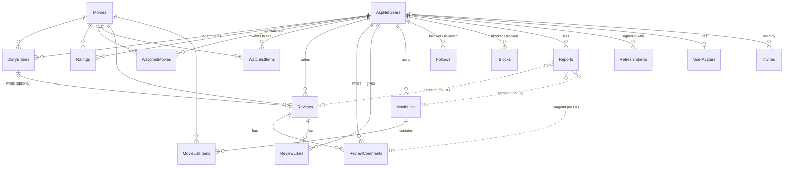

# Data model and persistence

Reelr keeps all state in one SQL Server database, accessed through one EF Core context, `ReelrContext` (`backend/Data/ReelrContext.cs`). This document describes the entities, their relationships and constraints, how data is read and written, and how API contracts differ from the stored shape. The authoritative schema is `backend/Migrations/ReelrContextModelSnapshot.cs`; everything below was checked against it.

## Overview

Dotted lines are logical links without a foreign key: a report keeps its target type and id even after the item is removed.

## Entities

Column lengths come from constants on the entity classes and are applied in `OnModelCreating`. All timestamps are stored as UTC `datetime2` values set with `DateTime.UtcNow`.

### Users and accounts

| Entity (table) | Key | Purpose and notable columns |
|---|---|---|
| `User` (`AspNetUsers`) | `Id` (int, identity) | ASP.NET Core Identity user (`IdentityUser<int>`). Added: `ProfileImageUrl` (200), `WatchlistVisibility` (default `Followers`), `DiaryVisibility` (default `Public`), `TermsAcceptedAt`, `ShowFriendReviews`, `ShowOwnActivity`. Unique filtered index on `NormalizedUserName`; non-unique index on `NormalizedEmail`. |
| Identity tables (`AspNetRoles`, `AspNetUserRoles`, `AspNetUserClaims`, `AspNetUserLogins`, `AspNetUserTokens`, `AspNetRoleClaims`) | Identity defaults | Created by `IdentityDbContext`. Roles, claims and external logins are not used by Reelr code. |
| `UserAvatar` (`UserAvatars`) | `UserId` (1:1 with user) | Avatar bytes (`varbinary(max)`), `ContentType` (always `image/webp`), `UpdatedAt`. In its own table so loading a user never loads image bytes. |
| `RefreshToken` (`RefreshTokens`) | `Id` (bigint) | SHA-256 `TokenHash` (char 64, unique), `FamilyId` (one per login), `SecurityStamp` snapshot, `CreatedAt`, `ExpiresAt`, `UsedAt`, `RevokedAt`. Indexes on `FamilyId` and (`UserId`, `ExpiresAt`). |
| `Invite` (`Invites`) | `Id` | SHA-256 `CodeHash` (char 64, unique), `Note` (100), `CreatedAt`, `UsedAt`, `UsedById` (nullable FK, `SET NULL` on user delete), `RevokedAt`. |
| `DataProtectionKey` (`DataProtectionKeys`) | `Id` | ASP.NET Core Data Protection key ring, stored here so email links survive restarts and new containers. |

### Films

| Entity (table) | Key | Purpose and notable columns |
|---|---|---|
| `Movie` (`Movies`) | `Id` (local) | A local copy of a TMDB film: `TmdbId` (unique), `Title` (500), `Description` (4000), `ReleaseDate` (date), `Runtime`, `PosterUrl` and `BackdropUrl` (300, TMDB image paths, not full URLs), `RefreshedAt` (indexed). Created only by `MovieCatalog.GetOrCreateAsync`; never deleted by application code. |

### Journal

| Entity (table) | Key | Purpose and notable columns |
|---|---|---|
| `WatchedMovie` (`WatchedMovies`) | (`UserId`, `MovieId`) | Current watched state: `WatchedAt` (latest diary watch date), `Liked` (nullable), `Rewatched`. |
| `Rating` (`Ratings`) | (`UserId`, `MovieId`) | Current score, `decimal(2,1)`, check `CK_Ratings_Score` (0.5 to 5 in half steps). |
| `DiaryEntry` (`DiaryEntries`) | `Id` | One logged viewing: `WatchedAt` (editable, stored at 12:00 UTC for a picked day), `LoggedAt` (never changes), snapshot `Rating` (`decimal(2,1)`, nullable, check `CK_DiaryEntries_Rating`), `Liked`, `Rewatched`, and computed stored column `IsBackdated` (`LoggedAt` more than 14 days after `WatchedAt`). Indexes: (`UserId`, `WatchedAt`), (`UserId`, `LoggedAt`), (`IsBackdated`, `LoggedAt`), `MovieId`. |
| `WatchlistItem` (`WatchlistItems`) | (`UserId`, `MovieId`) | `AddedAt`. Index (`UserId`, `AddedAt`). |

`WatchedMovie` and `Rating` hold the current state; `DiaryEntry` is the history. `JournalService` keeps them consistent (see [PROJECT_OVERVIEW.md](PROJECT_OVERVIEW.md#journal-rules-backendfeaturesdiaryjournalservicecs)).

### Reviews

| Entity (table) | Key | Purpose and notable columns |
|---|---|---|
| `Review` (`Reviews`) | `Id` | `Text` (`nvarchar(max)` with check `CK_Reviews_Text`, at most 5000 characters), `ContainsSpoilers`, `CreatedAt`, `UpdatedAt`, `ActivityAt` (feed time), optional `DiaryEntryId`. Unique (`UserId`, `MovieId`); unique filtered `DiaryEntryId`; indexes (`MovieId`, `CreatedAt`), (`UserId`, `CreatedAt`), `ActivityAt`, (`UserId`, `ActivityAt`). |
| `ReviewComment` (`ReviewComments`) | `Id` | Plain text (1000), `CreatedAt`, `UpdatedAt`. Indexes (`ReviewId`, `CreatedAt`), `UserId`. |
| `ReviewLike` (`ReviewLikes`) | (`ReviewId`, `UserId`) | `CreatedAt`. Indexes `UserId`, (`ReviewId`, `CreatedAt`). |

### Lists

| Entity (table) | Key | Purpose and notable columns |
|---|---|---|
| `MovieList` (`MovieLists`) | `Id` | `Name` (100), `Description` (1000), `IsPublic` (default true), `CreatedAt`, `UpdatedAt`. Indexes (`UserId`, `CreatedAt`), (`IsPublic`, `CreatedAt`). |
| `MovieListItem` (`MovieListItems`) | (`MovieListId`, `MovieId`) | `AddedAt`. Indexes `AddedAt`, (`MovieListId`, `AddedAt`), `MovieId`. |

### Social and moderation

| Entity (table) | Key | Purpose and notable columns |
|---|---|---|
| `Follow` (`Follows`) | (`FollowerId`, `FollowedId`) | Check `CK_Follows_NotSelf`. Index `FollowedId`. No timestamp. |
| `Block` (`Blocks`) | (`BlockerId`, `BlockedId`) | `CreatedAt`. Check `CK_Blocks_NotSelf`. Index `BlockedId`. |
| `Report` (`Reports`) | `Id` | `ReporterId`, `TargetType` (`Review`, `Comment`, `List`; stored as int), `TargetId` (no FK), `Reason` (enum), `Note` (500), `CreatedAt`, `ResolvedAt`, `ResolvedById` (no FK), `Outcome`. Unique filtered index (`ReporterId`, `TargetType`, `TargetId`) where `ResolvedAt IS NULL` (one open report per reporter and item); index (`ResolvedAt`, `TargetType`, `TargetId`). |

Enums (`WatchlistVisibility`, `DiaryVisibility`, `ReportTargetType`, `ReportReason`, `ReportOutcome`) are stored as integers and serialised as strings in JSON (`JsonStringEnumConverter` attributes on the enums).

## Relationships and delete behaviour

| From -> to | Cardinality | On delete of parent | Why |
|---|---|---|---|
| User -> DiaryEntries, Ratings, WatchedMovies, WatchlistItems, Reviews, MovieLists, Reports (as reporter), RefreshTokens, UserAvatar | 1 to many (avatar 1 to 0..1) | Cascade | Owned data goes with the account. |
| User -> ReviewLikes, ReviewComments, Follows, Blocks | 1 to many | Restrict | SQL Server rejects a second cascade path (users already cascade to reviews). `UserController.DeleteUser` deletes these rows in a transaction first. |
| User -> Invite (`UsedById`) | 1 to 0..1 | Set null | The invite stays marked as used. |
| Movie -> DiaryEntries, Ratings, WatchedMovies, WatchlistItems, Reviews | 1 to many | Cascade | Films are not deleted in practice. |
| Movie -> MovieListItems | 1 to many | Restrict | |
| Review -> ReviewLikes, ReviewComments | 1 to many | Cascade | Removing a review (by its author or an admin) removes its likes and comments. |
| DiaryEntry -> Review (`DiaryEntryId`) | 0..1 to 0..1 | No action | Second cascade path again. `JournalService.DeleteEntriesAsync` deletes the linked review in code. |
| MovieList -> MovieListItems | 1 to many | Cascade | |

## Data access patterns

- **Direct EF Core in controllers.** There is no repository layer. Controllers query `ReelrContext` with LINQ and project straight into DTOs with `Select`, so only needed columns are read and entities are not tracked for reads.
- **Set-based writes.** Bulk changes use `ExecuteUpdateAsync` and `ExecuteDeleteAsync` (for example token rotation, invite claiming, unlike, account deletion, report resolution). These bypass the change tracker and run immediately.
- **Atomic claims.** Refresh tokens and invites are claimed with a conditional `UPDATE ... WHERE UsedAt IS NULL` and a row-count check, so two concurrent requests cannot both succeed (`RefreshTokens.RotateAsync`, `InviteCodes.ClaimAsync`).
- **Check-then-insert plus unique index.** Endpoints check for duplicates before inserting; if two requests race, the primary key or unique index rejects the second and `UniqueConflictExceptionHandler` returns 409. `MovieCatalog` instead catches the failure and re-reads the film, and `ReviewLikeController.Like` treats a lost race as success.
- **Explicit transactions** where several saves must agree: diary edits and deletes (`JournalService`), registration with an invite, blocking, account deletion, report resolution.
- **Keyset paging.** List endpoints sort by (date or name, id) and continue after a cursor that encodes those values (`Features/Paging`). Indexes such as (`UserId`, `WatchedAt`) and (`MovieId`, `CreatedAt`) support these orders.
- **Derived reads.** The activity feed has no table; `DerivedActivityFeed` reads diary entries, reviews, lists, list items and watchlist items with time windows and merges them in memory.
- **Connection resilience.** `OpenRetryInterceptor` retries opening a connection on transient Azure SQL error numbers. Queries and transactions themselves are not retried.

## Validation and persistence workflow

Validation happens in three layers:

1. **DTO attributes**, checked automatically by `[ApiController]` before an action runs: `[Required]`, `[MaxLength]`, `[MinLength]`, `[EmailAddress]`, `[Range]`, the custom `[HalfStars]`, and `PageQuery.Validate` for cursors. Failures return a 400 `ValidationProblem`.
2. **Controller and service checks**: ownership (`UserId == caller`), existence, watch date range (`JournalService.ValidateWatchedOn`), enum values (`Enum.IsDefined`), blank review text, block rules, visibility.
3. **Database constraints**: primary keys, unique indexes, check constraints (`CK_Ratings_Score`, `CK_DiaryEntries_Rating`, `CK_Reviews_Text`, `CK_Follows_NotSelf`, `CK_Blocks_NotSelf`) and column lengths. These are the last line of defence; `HalfStarsAttribute` and the half-star check constraint use the same rule.

Film data from TMDB is trimmed to fit (`MovieCatalog.CopyFrom` cuts long titles and descriptions and drops image paths longer than 300 characters).

## Entities versus API contracts

DTOs live in each feature's `DTOs/` folder. The SPA mirrors them in `frontend/src/lib/types.ts`. Important differences from the stored shape:

| Aspect | Database | API |
|---|---|---|
| Film identity | Local `Movie.Id` used in every foreign key | Only `tmdbId` appears in routes and DTOs. The local id is never exposed. |
| Composition | Normalised tables | Read DTOs flatten joins: `ReviewDto` carries author name and avatar, film title and poster, the author's current rating (`Score`), the linked diary entry's `WatchedAt`, like and comment counts and `LikedByMe`. |
| Secrets | Hashes for refresh tokens and invite codes | The raw invite code is returned once (`CreatedInviteDto`); refresh tokens only travel in the cookie. |
| Per-viewer fields | Not stored | `LikedByMe`, `IsFollowing`, `IsBlocked`, `CanSeeDiary`, `CanSeeWatchlist`, `WatchedCount`, `IsAdmin`, `IsDemo` are computed for the caller. |
| TMDB data | Only a few `Movie` columns | `MovieDetailsDto`, `PersonDetailsDto` and the `Tmdb*Dto` classes pass TMDB data through without storing it. |
| Feed | No table | `ActivityItemDto`, `ActivityPageDto`, `FollowingFilmDto` are built at read time. |
| Paging | Not stored | `PageDto<T>` (`items`, `nextCursor`), and `MovieReviewPageDto` adds `totalCount`. |
| Timestamps | UTC without kind | Most DTO timestamps are serialised without a `Z` suffix; activity, invite and admin report timestamps are marked UTC explicitly. See [TECHNICAL_DEBT.md](TECHNICAL_DEBT.md). |
| Export | All tables for one user | `DataExport.BuildAsync` returns an anonymous object, not a DTO class. |

## ORM configuration

- EF Core 10 with the SQL Server provider (`backend/backend.csproj`).
- Context registered in `backend/Program.cs` with the `ReelrContext` connection string and `OpenRetryInterceptor`. No lazy loading; navigation properties are loaded with `Include` or projections.
- `ReelrContextFactory` builds the context for design-time tools from `appsettings*.json`, user secrets and environment variables, without starting the app.
- No global query filters, value converters or soft deletes.

## Migrations

- 22 migrations in `backend/Migrations/`, from `20260907141742_InitialCreate` to `20261012142931_AddInvites`.
- Create: `dotnet ef migrations add <Name> --project backend/backend.csproj`. Apply locally: `dotnet ef database update --project backend/backend.csproj`.
- The app never migrates at start-up. In Docker Compose the `migrate` service runs an EF migrations bundle (`backend/Dockerfile`, target `migrations`) before the backend starts. In Azure the `reelr-migrate` Container Apps job runs the same bundle, under an identity with `db_owner`, before each rollout (`.github/workflows/deploy.yml`).
- CI runs `dotnet ef migrations has-pending-model-changes` and applies every migration to an empty database (`.github/workflows/ci.yml`).
- Integration tests create their databases with `EnsureCreated`, not migrations.

## Data lifecycle

| Data | Lifetime | Evidence |
|---|---|---|
| Member content | Until the member deletes it or the account | Cascades and `UserController.DeleteUser` |
| Refresh tokens | Expired rows are deleted when the same user next gets a token; used rows are kept until expiry to detect reuse | `RefreshTokens.AddAsync` |
| Reports | Kept after resolution; deleted with the reporter's account | `Report` configuration |
| Films | Kept indefinitely, refreshed when older than 30 days | `MovieRefresher`, `MovieRefreshOptions` |
| Azure SQL backups | 7 days point-in-time | Root README |
